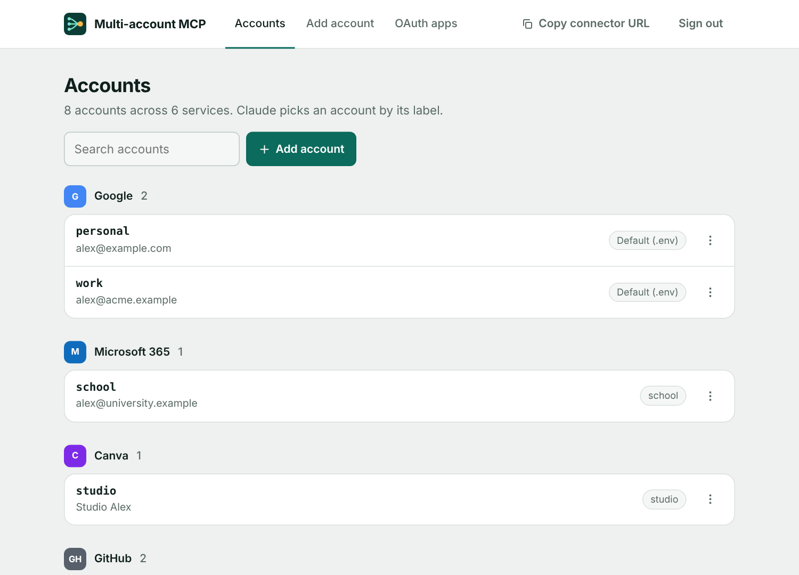
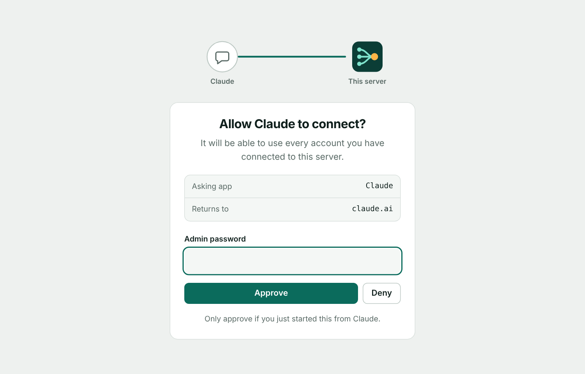
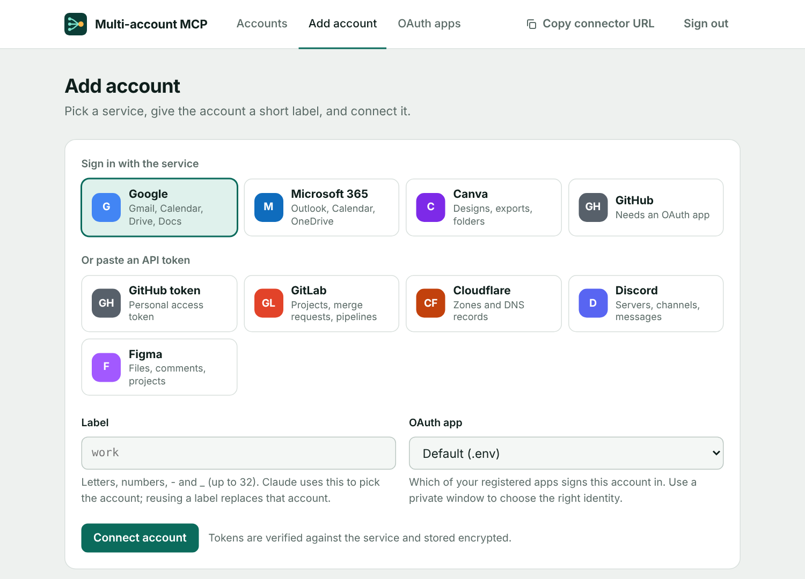

# Multi-account MCP

[](https://github.com/fmgoliveira/mcp-server/actions/workflows/ci.yml)
[](LICENSE)

A self-hosted [MCP](https://modelcontextprotocol.io) server that lets Claude use **several accounts per service at the same
time**: two Google accounts, a work and a personal GitHub, three Canva teams. You add it to Claude once as a custom
connector. Every tool takes an `account` label, and list and search tools fan out over all accounts when you leave it out.

<p align="center">
  
  
</p>

## What it can do

| Service | Connect with | Tools |
|---|---|---|
| Google | OAuth | Gmail, Calendar, Drive, Docs, Sheets, Slides, Forms, plus `google_api` |
| Microsoft 365 | OAuth | Outlook mail and calendar, OneDrive and SharePoint files, Excel ranges, plus `graph_api` |
| Teams (optional) | Microsoft OAuth | Teams, channels, channel and chat messages, sending |
| Canva | OAuth (PKCE) | Designs, create, export, folders, assets, brand templates and autofill, plus `canva_api` |
| GitHub | GitHub App, OAuth App or token | Repos, search, your work, notifications, files, commits, Actions, issues, pull requests, plus `github_api` |
| GitLab | API token (self-hosted works) | Projects, merge requests, issues, pipelines, plus `gitlab_api` |
| Cloudflare | API token | Zones and DNS records, plus `cloudflare_api` |
| Discord | Bot token | Servers, channels, read and send messages, plus `discord_api` |
| Figma | API token | Files, projects, comments, image export, plus `figma_api` |

Read-only tools are annotated as such, so Claude can auto-allow reads and ask before anything that sends, edits or
deletes. Every service has an `*_api` escape hatch for calls that don't have a dedicated tool yet.
Not available: Microsoft Forms (no public API). Word and PowerPoint files are read as text but not edited in place.

## Quick start

You need a machine with Docker and a public HTTPS hostname that points at it.

```bash
git clone https://github.com/fmgoliveira/mcp-server && cd mcp-server
cp .env.example .env
openssl rand -base64 32   # paste as ENCRYPTION_KEY
openssl rand -base64 24   # paste as ADMIN_PASSWORD
# set PUBLIC_URL=https://your-hostname in .env
docker compose up -d --build
```

The container listens on port 5757 of the host. Put a reverse proxy with TLS in front of it and forward your hostname to
`127.0.0.1:5757`. The included `Caddyfile` is a starting point if you run Caddy in the same compose network.

Then:

1. Open `https://your-hostname/admin` and sign in with `ADMIN_PASSWORD`.
2. Create an OAuth app for each OAuth service you want ([setup guides](#provider-setup)) and save it under **OAuth apps**.
3. Under **Add account**, pick a service, choose a short label such as `work`, and finish the consent screen. API-token
   services only need a pasted token.
4. In Claude, go to **Settings → Connectors → Add custom connector** and enter `https://your-hostname/mcp`. Approve the
   connection with your admin password when Claude opens the authorization page.
5. Try *"List my connected accounts"*, *"Which pull requests need my review?"* or *"Search all my inboxes for the invoice
   from Acme"*.

<p align="center"></p>

## Configuration

Everything is set through environment variables (see [`.env.example`](.env.example)). OAuth client IDs and secrets can also
be added in **/admin → OAuth apps**, which is handy when you need several apps for one service.

| Variable | Required | Purpose |
|---|---|---|
| `PUBLIC_URL` | yes | Public HTTPS URL of the server, without a trailing slash. Used for OAuth redirects. |
| `ADMIN_PASSWORD` | yes | Unlocks `/admin` and approves new MCP clients. Use a long random value. |
| `ENCRYPTION_KEY` | yes | 32 random bytes, base64. Encrypts everything stored on disk. Losing it makes the state unreadable. |
| `GOOGLE_CLIENT_ID` / `_SECRET` | no | Default Google OAuth client. |
| `MS_CLIENT_ID` / `_SECRET` | no | Default Microsoft Entra app. |
| `CANVA_CLIENT_ID` / `_SECRET` | no | Default Canva integration. |
| `GITHUB_CLIENT_ID` / `_SECRET` | no | Default GitHub App or OAuth App. |
| `GOOGLE_SCOPES`, `MS_SCOPES`, `CANVA_SCOPES`, `GITHUB_SCOPES` | no | Override the requested scopes (space separated). |
| `MS_TEAMS` | no | Set to `1` to request Teams scopes. Reconnect the Microsoft accounts that need Teams. |
| `PORT` | no | Listening port, default `3000` (the container publishes it as 5757). |
| `DATA_DIR` | no | Where `state.enc` is stored, default `./data`. |

State lives in the bind-mounted `./data` folder. Back it up, and keep `ENCRYPTION_KEY` somewhere separate.

## Provider setup

Every OAuth redirect URL has the form `https://your-hostname/oauth/<service>/callback`. The **OAuth apps** page lists them
with a copy button.

<details>
<summary><b>Google</b></summary>

1. In [Google Cloud Console](https://console.cloud.google.com), create a project and enable the Gmail, Calendar, Drive,
   Docs, Sheets, Slides and Forms APIs.
2. Configure the OAuth consent screen as **External** and add each account you will connect as a test user. Then
   **publish the app** ("In production"). Apps left in "Testing" get refresh tokens that expire after 7 days. Unverified
   production apps work for up to 100 users and show a "Google hasn't verified this app" warning. If all accounts belong
   to one Workspace organization, choose **Internal** instead.
3. Create an OAuth client ID of type *Web application* with the redirect URI `https://your-hostname/oauth/google/callback`.
</details>

<details>
<summary><b>Microsoft 365</b></summary>

1. In [Microsoft Entra](https://entra.microsoft.com) → App registrations, create an app that supports **accounts in any
   organizational directory and personal Microsoft accounts**.
2. Add the Web redirect URI `https://your-hostname/oauth/microsoft/callback` and create a client secret.
3. Work and school tenants may require admin consent for `Files.ReadWrite.All` and `Sites.ReadWrite.All`. If you can't get
   it, set `MS_SCOPES="offline_access User.Read Mail.ReadWrite Mail.Send Calendars.ReadWrite Files.ReadWrite"`.
4. Teams is opt-in: set `MS_TEAMS=1` and reconnect the account. Reading channel messages needs tenant admin consent.
</details>

<details>
<summary><b>Canva</b></summary>

1. At [canva.com/developers](https://www.canva.com/developers) create a private integration and enable the scopes
   `profile:read`, `design:meta:read`, `design:content:read`, `design:content:write`, `asset:read`, `asset:write`,
   `folder:read`, `folder:write` (plus `brandtemplate:meta:read` and `brandtemplate:content:read` on Enterprise).
2. Set the redirect URL to `https://your-hostname/oauth/canva/callback`.
3. Draft and private integrations only authorize their owner. For several Canva accounts, create one integration per
   account and add each under **OAuth apps**.
</details>

<details>
<summary><b>GitHub</b></summary>

Recommended: a **GitHub App** (Settings → Developer settings → GitHub Apps).

1. Set the callback URL to `https://your-hostname/oauth/github/callback`, keep "Expire user authorization tokens" on and
   turn webhooks off.
2. Repository permissions: Contents (read and write), Issues (read and write), Pull requests (read and write), Actions
   (read), Metadata (read).
3. Generate a client secret and save the app under **OAuth apps**.
4. **Install the app** on every user or organization whose repositories Claude should see. User tokens only reach
   repositories where the app is installed and you have access.

GitHub Apps can't read notifications. For those, use a classic **OAuth App** with the same callback URL and
`GITHUB_SCOPES="repo read:user notifications"`. Its tokens don't expire. A personal access token (one per organization) also
works: add it under **Add account → GitHub token**.
</details>

<details>
<summary><b>GitLab, Cloudflare, Discord, Figma (API tokens)</b></summary>

Create a token on the service and paste it under **Add account**. It is verified against the service and stored encrypted.

- **GitLab:** a personal or group access token with the `api` scope. Set the base URL for self-hosted instances.
- **Cloudflare:** an API token scoped to the zones you need (Zone:Read, DNS:Edit).
- **Discord:** a bot token. Invite the bot to your server and enable the Message Content intent to read messages.
- **Figma:** a personal access token with file content and comments access.

Tokens don't refresh. When one expires, add the same label again with a new token.
</details>

## Security

- All accounts, OAuth app secrets and tokens are stored in one AES-256-GCM encrypted file, `data/state.enc`.
- Claude authenticates to this server with OAuth 2.1 (dynamic client registration, PKCE). Approving a client needs the
  admin password, and failed attempts are rate limited.
- Tool calls can only reach an allowlist of upstream hosts, so a stored token is never sent anywhere else.
- Anyone with the admin password can connect a client that can use **every** account. Use a long random password, serve
  over HTTPS only, and run one instance per group of people who trust each other.

See [SECURITY.md](SECURITY.md) for the full model, a hardening checklist and how to report a vulnerability.

## Development

```bash
npm install
cp .env.example .env
npm run dev      # tsx with .env loaded, http://localhost:3000/admin
npm run build    # compiles to dist/ and doubles as the typecheck
npm start        # runs the built server
```

```
src/
  server.ts          Express app, OAuth endpoints for Claude, /mcp, security headers
  auth-provider.ts   MCP OAuth provider and the authorization page
  admin.ts, ui.ts    Admin UI (server-rendered) and shared HTML pieces
  store.ts           Encrypted state: accounts, OAuth apps, MCP clients, tokens
  providers.ts       OAuth connect and token refresh per service
  tokens.ts          API-token verification
  api.ts             The only place that calls upstream APIs (allowlist, retry, truncation)
  tools/             One file per service, each exposing registerX(server)
public/              Favicon and the admin UI's stylesheet and script
```

More detail for contributors, including how to add a provider, is in [CONTRIBUTING.md](CONTRIBUTING.md).

## Roadmap

Ideas that would make this more useful. Open an issue if one matters to you.

- A **Test connection** button and status on each account, with warnings for expiring tokens
- Per-account **read-only mode** and per-tool switches, so a work account can be locked to reads
- An **activity log** of tool calls (time, account, tool, result) in the admin UI
- A list of connected **Claude clients** with revoke
- Account **groups and defaults**, for example "all work accounts"
- Passkey or TOTP sign-in for the admin UI
- More services: Slack, Notion, Linear, Atlassian, Dropbox
- Encrypted export and import of the state file, and an `ENCRYPTION_KEY` rotation command
- Automated tests

## License

[MIT](LICENSE)
